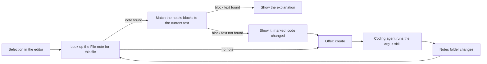

# Argus for VS Code: design (version 3.0)

## Status

- 2026-11-15: first draft, written by the agent under the owner's autonomy instruction (decide, record, carry on). Not yet reviewed by Codex.
- Owner's request, in his words: "select the lines of code and explanation comes from the skill (either fetched or created at that time: if I have run the skill once that is fetched, or else created)". VS Code extension first; a localhost page in the next release.

## Goal

In VS Code, a person selects lines of code and sees their Argus explanation beside the code: purpose, the block's code, the line-by-line table, and the concepts with their notes. The explanation is read from the Argus notes when they exist. When they do not exist, or are out of date, the person can have them created; they are then saved as notes, so the next look is instant.

## What it is not

| Not in 3.0 | Why |
|---|---|
| No LLM call from the extension | The coordinator of the AURA work confirmed there is no supported plain-HTTP route for a custom extension. The LLM work is done by a coding agent that is already set up on the computer |
| No change to the note format | The notes the skill writes today are the data. The extension only reads them |
| No publishing to the VS Code Marketplace | Publishing outside the owner's repositories is his decision. 3.0 ships as a `.vsix` file |
| No localhost page | Version 3.1, reusing the same core |
| No editing of notes from the panel | Notes are edited in Obsidian or by the skill |

## How it works

| Step | What happens | LLM used |
|---|---|---|
| 1. Index | On start, and whenever a note file changes, the extension reads every File note in the notes folder: its properties (`source`, `commit`, `depth`), its lens table, and each block (id, purpose, recorded line range, the copied code, the explanation under it) | No |
| 2. Look up | The path of the open file, relative to the source root, is compared with each note's `source` | No |
| 3. Match | Each block's copied code is searched for in the current text of the file. Found: the block's lines are where the text is now, whatever the recorded numbers say. Not found: that block's code changed since the note was written | No |
| 4. Show | The blocks that overlap the selection are shown in the Argus panel, with the selected lines highlighted in the line table | No |
| 5. Create | When there is no note, or the selection lies in changed code, the panel offers "Create explanation". That runs the create command (below) and waits for the notes folder to change | Yes, in the agent |

## Parts

| Part | Folder | Content | Depends on VS Code |
|---|---|---|---|
| Core | `vscode/src/core/` | `notes.ts`: reads a note (properties, fence-aware sections, blocks, tables). `match.ts`: finds a block's code in a text and maps a selection to blocks. `links.ts`: finds `[[links]]` and resolves them to note files | No. Version 3.1 reuses it |
| Index | `vscode/src/index.ts` | Keeps the notes of the notes folder in memory; refreshes on file changes | Yes (file watcher) |
| Panel | `vscode/src/panel.ts`, `vscode/media/` | A webview in the side bar that renders the explanation | Yes |
| Commands | `vscode/src/extension.ts` | Registers commands, the context menu entry, the markers in the editor | Yes |
| Create | `vscode/src/create.ts` | Builds and runs the create command | Yes |

The parsing rules in `notes.ts` are the same as in `skills/argus/scripts/check_notes.py`: headings are read outside code fences only; a block heading is `### Block <id>: <purpose> (lines a-b)` or `(line a)`; the first fence after it is the code; rows that start with a line number or range are line rows.

## Settings

| Setting | Meaning | Default |
|---|---|---|
| `argus.notesFolder` | Folder that holds the Argus notes | none; the panel asks for it once |
| `argus.vaultFolder` | Root of the Obsidian vault, to resolve links to shared Concept and Library notes and to open notes in Obsidian | the notes folder |
| `argus.sourceRoot` | The folder that the notes' `source` paths are relative to | the workspace folder |
| `argus.createCommand` | The program and arguments that create an explanation, as a list. Placeholders: `${file}`, `${startLine}`, `${endLine}`, `${notesFolder}`, `${sourceRoot}`, `${depth}` | `["claude", "-p", "Use the argus skill. Explain ${file}, depth ${depth}. Source root: ${sourceRoot}. Put the notes in ${notesFolder}."]` |
| `argus.createDepth` | Depth asked for on create | `full` |

## Commands and what the person sees

| Command | Where | Result |
|---|---|---|
| Argus: Explain selection | Right-click in the editor; command palette | The panel opens on the blocks under the selection |
| Argus: Explain this file | Command palette; the editor title menu | The panel shows the file's purpose table and the list of blocks |
| Argus: Create explanation | Button in the panel when there is no note or the code changed | Runs the create command; the panel shows "working" and refreshes when notes arrive |
| Argus: Refresh notes | Command palette | Reads the notes folder again |
| Argus: Open note in Obsidian | Button in the panel | Opens the note through an `obsidian://` link |

| Marker in the editor | Meaning |
|---|---|
| A thin coloured bar beside lines | These lines have a current explanation |
| The same bar in a warning colour | These lines belong to a block whose code changed since the note was written |
| A line of grey text above a block's first line | The block's purpose, as a CodeLens; a click opens the panel on it |

The panel, top to bottom: the file's name and note state (current, changed, none); the lens table, folded; for each block under the selection, its purpose, its code, its explanation (the line table at `full`, the sentences at `map`); the concepts of that block as links. A click on a concept shows that Concept note in the panel, with a way back.

## The create step

| Point | Decision | Reason |
|---|---|---|
| Who does the LLM work | A coding agent on the computer, started by the create command. Default: Claude Code, non-interactive (`claude -p`) | It already runs the argus skill; with AURA connected to it, the work goes through AURA without the extension knowing AURA at all |
| How the command is run | As a program with an argument list, never through a shell | A file path or a line number cannot become a command |
| What is created | The whole file's note at the asked depth, not only the selected lines | The skill's unit is the file; the check works on whole files |
| Where the output goes | An "Argus" output channel in VS Code | The person can read what the agent did |
| When it is done | The index sees the note change and the panel refreshes | No protocol with the agent is needed |
| Failure | The command ends with an error, or no note appears: the panel says so and points to the output channel | No silent failure |
| graphify missing | The skill stops and says so; the text appears in the output channel | The skill's own rule |

## Safety

| Risk | Handling |
|---|---|
| A workspace sets `argus.createCommand` to run something harmful | `package.json` declares `capabilities.untrustedWorkspaces` as `{"supported": "limited", "restrictedConfigurations": ["argus.createCommand", "argus.notesFolder", "argus.vaultFolder", "argus.sourceRoot"]}`: in Restricted Mode VS Code gives the extension only the user's own value of those settings, never the workspace's. The create command is also switched off until the workspace is trusted. In a trusted workspace the workspace value of `argus.createCommand` is still ignored: the extension reads only the user-level value (`inspect().globalValue`) |
| A note contains HTML or script | The webview's content security policy is `default-src 'none'`, styles and images from the extension's own `media` folder only (`webview.cspSource`), scripts only with a nonce made new for each render. `localResourceRoots` is the `media` folder alone. Note text reaches the page through a small Markdown renderer that escapes HTML first |
| A message from the page to the extension | Only three message kinds are accepted (open a note by name, open in Obsidian, create); each is checked against the index before anything is done. A note name that is not in the index is refused |
| Links in notes | `[[links]]` open notes inside the panel; `obsidian://` links open Obsidian; any other link is shown as text with its address and opened only on a click, through VS Code's own "open external" prompt |
| Secrets | The extension shows what the notes hold; the skill's rule keeps secrets out of notes. The extension sends nothing anywhere |
| Source code leaving the computer | Only through the coding agent the person has set up, as in any use of that agent |

## Lens

| Lens | Answer |
|---|---|
| In one sentence | The Argus notes, shown beside the code they explain, for the lines the person points at |
| What we gain | The explanation is one click from the code. Reading notes no longer means finding the right note and the right block by hand. The marker shows at a glance which code is explained and which explanation is out of date |
| What we lose | A second thing to build, test and release besides the skill. The parsing rules exist twice (Python check, TypeScript core) and must be kept the same |
| What was not possible without it | Asking "what does this line do" from inside the editor and getting the stored, checked explanation rather than a fresh, unchecked one |
| Issues today | None; not built |
| What it makes possible | The 3.1 localhost page on the same core; later, an AURA route (an MCP client of the local `aura mcp` server) without changing the panel |
| Open source used | TypeScript, the VS Code extension API, `@vscode/vsce` to package. No runtime library |
| Risks | Block matching by text fails when the same code appears twice in a file (handled: the match nearest the recorded line wins). A note format change in the skill must be made in both parsers |

## Decisions made by the agent

| Question | Decision | Reason |
|---|---|---|
| Side panel or a tab beside the editor | Side bar view | It stays open while the person moves through files |
| Render Markdown how | A small renderer in the extension for the subset the notes use (headings, tables, code, bold, inline code, links) | No runtime dependency; full control over escaping |
| Match unit | The block's whole copied code, with line endings and trailing spaces ignored | Exact enough to trust, tolerant of editor settings |
| Same code twice in a file | The match nearest the recorded start line | The recorded line is a good hint even after edits |
| Selection outside every block | Show the nearest block before it, and say the selected lines are blank or not in a block | Blank lines belong to no block by the skill's rules |
| Tests | Plain Node tests of the core, next to the code; the extension itself is tried by hand in VS Code | Owner rule: small tests next to the code, no test machinery |
| Where the code lives | `vscode/` in the Argus repository | One repository, one handoff |
| Release form | `argus-<version>.vsix`, built with `@vscode/vsce`, attached to the repository; installed with "Install from VSIX" | No Marketplace account needed |

## Interface work

| Skill the owner named | Use in 3.0 |
|---|---|
| `ui-ux-pro-max` | The panel's layout, type, spacing and colour, following VS Code's theme variables so it fits light and dark themes; accessibility (keyboard reach, contrast, labels) |
| `a2ui` | Not used in 3.0. A2UI is for interfaces an agent generates at run time; this panel shows stored notes with a fixed layout. To be looked at again when "create" should show its progress as agent-made interface |

## Build order (for the plan)

| # | Piece | Done when |
|---|---|---|
| 1 | Core: `notes.ts` with tests on the three real example notes' shapes | The parsed blocks equal what `check_notes.py` sees |
| 2 | Core: `match.ts` with tests (moved code, changed code, code twice, selection across blocks) | Tests pass |
| 3 | Index and commands, panel with the explanation of a selection | Selecting lines in a file with a note shows the right block |
| 4 | Markers and CodeLens | Explained and changed blocks are marked |
| 5 | Concept links and "Open in Obsidian" | A click shows the Concept note |
| 6 | Create | A file without a note gets one through the create command |
| 7 | Package | A `.vsix` installs in a clean VS Code |

## Open points

| Point | Who decides |
|---|---|
| Publishing to the Marketplace | Owner |
| Publishing argus as an AURA skill, so AURA-connected agents load it by name | Owner, with the AURA coordinator |
| The later AURA route as an MCP client | Needs its own design and a review on the AURA side |
