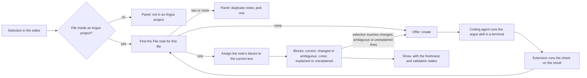

# Argus for VS Code: design (version 3.0)

## Status

- 2026-11-15: first draft, written by the agent under the owner's autonomy instruction (decide, record, carry on).
- 2026-11-15: revision 2, after Codex review round 1 (3 P1, 5 P2; all accepted). Changes: the states are defined; validation is separate from freshness and run by the extension itself; block matching is an ordered, non-overlapping assignment; unexplained lines are a state of their own; masked notes match; unsaved files, several projects and duplicate notes are defined; "create" runs in a visible terminal so the agent can ask.
- 2026-11-15: revision 3, after Codex review round 2 (2 P1, 2 P2; all accepted). Changes: the check's outcome is taken from its exit code and RESULT line, never from per-note lines alone; the checker itself refuses a `source` outside the source root; shared Concept and Library notes in the vault are indexed; masking follows the checker's rule exactly.
- Owner's request, in his words: "select the lines of code and explanation comes from the skill (either fetched or created at that time: if I have run the skill once that is fetched, or else created)". VS Code extension first; a localhost page in the next release.

## Codex review records

| Round | Outcome | Disposition |
|---|---|---|
| 1 | P0=0 P1=3 P2=5 P3=0, coverage complete | All 8 accepted and designed for in revision 2 (see "Review round 1" at the end) |
| 2 | P0=0 P1=2 P2=2 P3=0, coverage complete | All 4 accepted and designed for in revision 3 (see "Review round 2" at the end) |

## Goal

In VS Code, a person selects lines of code and sees their Argus explanation beside the code: purpose, the block's code, the line-by-line table, and the concepts with their notes. The explanation is read from the Argus notes when they exist. When they do not exist, or do not cover the selected lines, the person can have them created; they are then saved as notes, so the next look is instant.

Two questions are answered separately, and the panel always shows both:

| Question | Name | Answered by |
|---|---|---|
| Does this explanation describe the code as it is now? | Freshness | The extension, by comparing the note's copied code with the text in the editor |
| Did this note pass the Argus check? | Validation | The extension, by running `check_notes.py` itself and remembering the result |

## What it is not

| Not in 3.0 | Why |
|---|---|
| No LLM call from the extension | The coordinator of the AURA work confirmed there is no supported plain-HTTP route for a custom extension. The LLM work is done by a coding agent that is already set up on the computer |
| No change to the note format | The notes the skill writes today are the data. The extension only reads them |
| No publishing to the VS Code Marketplace | Publishing outside the owner's repositories is his decision. 3.0 ships as a `.vsix` file |
| No localhost page | Version 3.1, reusing the same core |
| No editing of notes from the panel | Notes are edited in Obsidian or by the skill |
| No explanation of untitled (never saved) documents | They have no path, so no note can name them |

## How it works

| Step | What happens | LLM used |
|---|---|---|
| 1. Index | On start, and whenever a note file changes, the extension reads every note that carries `written_by: argus` in each project's notes folder, and, when the project has a `vaultFolder`, the Concept and Library notes with that property anywhere in the vault (folders whose name starts with a dot are skipped). For each: properties (`type`, `source`, `commit`, `depth`, `masked_lines`), the lens table, and each block (id, purpose, recorded line range, the copied code, the explanation under it). Both folders are watched; a change refreshes the index | No |
| 2. Project | The open file's real path is compared with each project's source root. The file belongs to the project whose root contains it (the longest root wins) | No |
| 3. Look up | The file's path relative to that root is compared with the `source` of the notes of that project only | No |
| 4. Assign | The note's blocks are assigned to places in the editor's current text (see "Matching") | No |
| 5. Show | The blocks that overlap the selection are shown in the Argus panel, with their states and the selected lines highlighted in the line table | No |
| 6. Create | When there is no note, or the selection touches lines that are changed, ambiguous or unexplained, the panel offers "Create explanation" (see "The create step") | Yes, in the agent |
| 7. Validate | After a create, and on the command "Argus: Check notes", the extension runs the Argus check on that file's note and stores the result | No |

## States

| Thing | State | Meaning | Shown as |
|---|---|---|---|
| File | not in a project | The file is under no configured source root | Panel text; no markers |
| File | no note | No File note names it | Panel text and the Create button |
| File | duplicate notes | Two or more notes of one project name it | Panel lists them; the person picks one for this session; nothing is chosen for them |
| Block | current | Its copied code is in the editor text exactly (line endings aside), at one place, in order | Normal marker |
| Block | current (masked) | The same, where the note has `[masked]`: everything around each mask matches; fully masked lines are not compared | Normal marker with a lock sign; the panel shows the note's masked code, never the editor's text for those lines |
| Block | changed | Its code is not in the text exactly. This includes a difference only in spaces at line ends | Warning marker; the explanation is shown under "written for earlier code" |
| Block | ambiguous | Its code occurs at more than one place and the order of the blocks does not decide which | Warning marker at every candidate place; the panel says so and does not call it current |
| Line | unexplained | A non-blank line of the current text that no current block covers | Its own marker; selecting it offers Create |
| Note | checked | The last check run for this file ended with exit code 0 and a RESULT line ending in `PASS`, for this exact note text and source text | Badge "checked" |
| Note | checked without graph | The same, with a RESULT line ending in `PASS WITHOUT THE GRAPH CHECK` | Badge "checked, graph not used" |
| Note | check failed | The run ended with exit code 1. The panel shows every FAIL and MISSING line, grouped: lines that name this note; lines about the graph (`FAIL graph: ...`); lines about other notes of the same folder. Any of them keeps the badge at "check failed" | Badge "check failed" and the grouped lines |
| Note | check error | The check could not be run or did not finish: Python missing, exit code 2 (wrong arguments), any other exit code, no RESULT line, or the process was stopped | Badge "check error" and the reason |
| Note | not checked | No stored result for this note text and source text; or Python is not available | Badge "not checked" and why |

The validation result is stored with a hash of the note's text and a hash of the source file's saved text. A change to either makes the note "not checked" again.

## Matching

The note's blocks, in the order of their recorded line ranges, are assigned to the editor's current text.

| Rule | Detail |
|---|---|
| Text compared | Line by line. Line endings (CRLF or LF) are ignored. Everything else must be equal, spaces at line ends included |
| Masked lines | Exactly the checker's rule (`check_notes.py`, the code-fence comparison). A copied line without `[masked]` must equal the text line, whatever `masked_lines` says. A copied line with `[masked]` is accepted only when its recorded line number is in `masked_lines`; then, a line that is `[masked]` alone matches any one line, and any other masked line matches when the text around each mask equals the text line. A `masked_lines` entry for a line whose copy holds no mask changes nothing |
| Candidates | Every place in the text where a block's whole code matches |
| Assignment | Blocks keep their order and never overlap: block n+1 is assigned after the end of block n. Among the assignments that satisfy this, the one that assigns the most blocks wins; among those, the one whose places are nearest the recorded lines |
| Ambiguous | When two assignments are equally good and put a block at different places, that block is ambiguous |
| Changed | A block with no candidate, or none that fits the order, is changed. To place its marker, the extension looks for the same code with line-end spaces ignored; found: the marker sits there and the panel says "differs only in spaces at line ends"; not found: the marker sits at the recorded lines, clipped to the file |
| Unexplained | After the assignment, every non-blank line outside all current blocks |
| Large files | Matching is line-hash based and linear in the file's length for each block; it runs after the editor has been still for a short time, not on every keystroke |
| Unsaved changes | Matching always uses the text in the editor, saved or not, so the markers follow what the person sees |

Example the rules must handle: two identical blocks recorded at lines 10 and 100; 100 lines are inserted above both. Both now have candidates at 110 and 200. Order and no-overlap give 110 to the first and 200 to the second.

## Parts

| Part | Folder | Content | Depends on VS Code |
|---|---|---|---|
| Core | `vscode/src/core/` | `notes.ts`: reads a note (properties, fence-aware sections, blocks, tables). `match.ts`: the assignment above. `links.ts`: finds `[[links]]`. `projects.ts`: path rules. `markdown.ts`: the small renderer | No. Version 3.1 reuses it. A test loads every core file and fails if one imports `vscode` |
| Index | `vscode/src/index.ts` | Keeps the notes of each project in memory; refreshes on file changes | Yes (file watcher) |
| Panel | `vscode/src/panel.ts`, `vscode/media/` | A webview in the side bar that renders the explanation | Yes |
| Commands | `vscode/src/extension.ts` | Registers commands, the context menu entry, the markers in the editor | Yes |
| Create | `vscode/src/create.ts` | Starts the agent in a terminal, follows it, runs the check | Yes |
| Check | `vscode/scripts/` | A copy of the skill's `check_notes.py` and `_common.py`, taken from `skills/argus/scripts/` when the extension is built | No |

Two parsers exist: the Python check (the authority on whether a note is valid) and the TypeScript core (for display and matching). They are kept in step this way: the build copies the Python files, never edits them; the core's tests parse the same sample notes that `test_scripts.py` builds and compare block ids, line ranges and code with what `check_notes.py` reports for them; a note the core cannot parse is shown as "cannot be read", never guessed at.

## Settings

| Setting | Meaning | Default |
|---|---|---|
| `argus.projects` | A list. Each entry: `sourceRoot` (folder the notes' `source` paths are relative to), `notesFolder` (folder with the Argus notes), `vaultFolder` (optional: root of the Obsidian vault, for shared Concept and Library notes and for opening Obsidian), `graph` (optional: path of a graphify `graph.json` for the check) | Empty; the panel asks for the notes folder once and uses the first workspace folder as the source root |
| `argus.createCommand` | The agent program and its arguments, as a list. Placeholders: `${file}`, `${notesFolder}`, `${sourceRoot}`, `${depth}` | `["claude", "Use the argus skill. Explain ${file}, depth ${depth}. Source root: ${sourceRoot}. Put the notes in ${notesFolder}."]` |
| `argus.createDepth` | Depth asked for on create | `full` |
| `argus.python` | The Python program for the check | `python` |

Path rules (`projects.ts`): every configured folder is turned into its real path; on Windows, comparison ignores letter case and treats `\` and `/` alike; a file belongs to a project only when its real path lies inside the source root; a note's `source` that is absolute, contains `..`, or leads outside the source root is ignored by the index and listed in the panel's "problems" line (the checker refuses the same notes on its own, see "Validation by the extension"); with several workspace folders, each needs its own entry in `argus.projects`, and a file under no entry is "not in a project".

A file that was renamed or moved has no note under its new path: it shows "no note". (A later version may notice that another note's blocks all match this file and suggest it.)

## Commands and what the person sees

| Command | Where | Result |
|---|---|---|
| Argus: Explain selection | Right-click in the editor; command palette | The panel opens on the blocks under the selection. An empty selection means the line of the cursor |
| Argus: Explain this file | Command palette; the editor title menu | The panel shows the file's purpose table and the list of blocks with their states |
| Argus: Create explanation | Button in the panel | See "The create step" |
| Argus: Check notes | Command palette; button in the panel | Runs the check for this file's note and shows the result |
| Argus: Refresh notes | Command palette | Reads the notes folders again |
| Argus: Open note in Obsidian | Button in the panel | Opens the note through an `obsidian://` link |

A selection that spans several blocks shows each of them in order. A selection that covers both explained and unexplained lines shows the explained blocks, lists the unexplained line ranges, and offers Create.

| Marker in the editor | Meaning |
|---|---|
| A thin bar beside lines | Current block |
| The same bar in a warning colour | Changed or ambiguous block |
| A dotted bar | Unexplained lines |
| A line of grey text above a block's first line | The block's purpose, as a CodeLens; a click opens the panel on it |

The panel, top to bottom: the file's name, the freshness summary (how many blocks current, changed, ambiguous; how many lines unexplained) and the validation badge; the lens table, folded; for each block under the selection, its state, purpose, code, explanation (the line table at `full`, the sentences at `map`); the concepts of that block as links. A click on a concept shows that Concept note in the panel, with a way back.

## The create step

| Point | Decision | Reason |
|---|---|---|
| Who does the LLM work | A coding agent on the computer. Default: Claude Code | It runs the argus skill; with AURA connected to it, the work goes through AURA without the extension knowing AURA at all |
| Where it runs | In a VS Code terminal that the person can see and type into, started with the program and its argument list directly (`shellPath` and `shellArgs`), with the source root as its folder | The skill sometimes asks (for example before reading code that carries a processing rule, or when graphify is missing). A visible terminal lets the person answer. No shell reads the arguments, so a file path cannot become a command |
| Before it starts | The file must be saved. With unsaved changes the panel offers "Save and create" or cancel; it never explains a version the person cannot see on disk. The extension records the hash of the saved text it asked about | The agent reads the file from disk |
| What is created | The whole file's note at the asked depth | The skill's unit is the file; the check works on whole files |
| While it runs | The panel shows "agent running in the terminal 'Argus'; answer it there if it asks". Notes that appear meanwhile are indexed as usual but stay "not checked" | A note on disk is not yet a finished, checked note |
| When it has ended | The terminal closes or its program exits. Then, in order: (1) exit code not 0: "the agent stopped with an error", terminal kept open; (2) no File note for the file, or its text is unchanged since before the start: "the agent finished without writing the note"; (3) otherwise the extension runs the check on that file and shows the result as the validation state | Completion is the process outcome plus the note plus the check, never the note alone |
| Edits during the run | After the run, matching compares the new note with the editor's text as it is then; lines edited meanwhile show as changed or unexplained | The result is tied to what the agent read |
| The agent is not installed | Starting the program fails: the panel says which program was not found and names the setting | No silent failure |
| The skill is not installed in the agent | The agent says so in the terminal; the person sees it. The extension's README says how to install the skill | The extension cannot look inside the agent |
| Python is not installed | Create still works; the validation state is "not checked: Python not found (`argus.python`)" | The check is separate from the display |

## Validation by the extension

| Point | Decision |
|---|---|
| Command | `<argus.python> -B <extension>/scripts/check_notes.py --notes <notesFolder> --source <sourceRoot> --scope <file> [--vault <vaultFolder>] (--graph <graph> or --no-graph)`, run as a program with an argument list |
| Result | Decided by the run as a whole, in this order: (1) the process could not start, was stopped, ended with a code other than 0 or 1, or printed no RESULT line: "check error"; (2) exit code 1: "check failed", with every FAIL and MISSING line shown, grouped as in "States"; (3) exit code 0 and RESULT ends in `PASS`: "checked"; (4) exit code 0 and RESULT ends in `PASS WITHOUT THE GRAPH CHECK`: "checked without graph". Nothing else counts as success. A failure in another note of the same folder, or in the graph, therefore keeps this note from showing "checked": the check certifies the folder's notes together, and the panel says which lines are not about this note |
| What the check reads | Every note with `written_by: argus` in the notes folder, not only this file's. The checker itself refuses a `source` that is absolute, contains `..` or resolves outside the source root (`on_disk` in `_common.py`: the path is resolved and must lie inside the root, before anything is read), and reports it as a FAIL. The extension does not rely on its own index to keep the checker inside the root |
| Stored | In the extension's workspace storage: note text hash, source text hash, state, the lines, the time |
| Never | The extension does not change a note to make it pass |

## Safety

| Risk | Handling |
|---|---|
| A workspace sets `argus.createCommand`, `argus.python` or `argus.projects` to run or read something harmful | `package.json` declares `capabilities.untrustedWorkspaces` as `{"supported": "limited", "restrictedConfigurations": ["argus.createCommand", "argus.python", "argus.projects"]}`: in Restricted Mode VS Code gives the extension only the user's own values. Create and Check are switched off until the workspace is trusted. `argus.createCommand` and `argus.python` are always read from the user's own settings (`inspect().globalValue`), never from the workspace, trusted or not |
| A note contains HTML or script | The webview's content security policy is `default-src 'none'`, styles and images from the extension's own `media` folder only (`webview.cspSource`), scripts only with a nonce made new for each render. `localResourceRoots` is the `media` folder alone. Note text reaches the page through the core's renderer, which escapes HTML first |
| A message from the page to the extension | Only these kinds are accepted: open a note by name, open in Obsidian, create, check, pick one of duplicate notes. Each is checked against the index before anything is done; a name that is not in the index is refused. A linked name is looked up first among the project's own notes, then among the shared Concept and Library notes of its vault; found once: shown; found more than once in the vault: the panel lists the places and the person picks; a file outside the notes folder and the vault folder (by real path) is never opened |
| Links in notes | `[[links]]` open notes inside the panel; `obsidian://` links open Obsidian; any other link is shown as text with its address and opened only on a click, through VS Code's own "open external" prompt |
| Secrets | The panel shows the note's code, which is masked where the skill masked it; for a masked block it never shows the editor's text. The extension sends nothing anywhere |
| Source code leaving the computer | Only through the coding agent the person has set up, as in any use of that agent |
| Paths | See "Path rules": real paths, containment in the source root, no `..` |

## Lens

| Lens | Answer |
|---|---|
| In one sentence | The Argus notes, shown beside the code they explain, for the lines the person points at, with a plain statement of whether each explanation is current and checked |
| What we gain | The explanation is one click from the code. The markers show which code is explained, which explanation is out of date, and which lines have none |
| What we lose | A second thing to build, test and release besides the skill. The note format is read by two parsers that must agree |
| What was not possible without it | Asking "what does this line do" from inside the editor and getting the stored, checked explanation rather than a fresh, unchecked one |
| Issues today | None; not built |
| What it makes possible | The 3.1 localhost page on the same core; later, an AURA route (an MCP client of the local `aura mcp` server) without changing the panel |
| Open source used | TypeScript, the VS Code extension API, `@vscode/vsce` to package. No runtime library |
| Risks | The assignment can be wrong for heavily repeated code; it then says "ambiguous" rather than guess. A note format change in the skill must reach both parsers; the shared sample tests catch a mismatch |

## Interface work

| Skill the owner named | Use in 3.0 |
|---|---|
| `ui-ux-pro-max` | The panel's layout, type, spacing and colour, following VS Code's theme variables so it fits light and dark themes; accessibility (keyboard reach, contrast, labels; states never shown by colour alone) |
| `a2ui` | Not used in 3.0. A2UI is for interfaces an agent generates at run time; this panel shows stored notes with a fixed layout. To be looked at again when "create" should show its progress as agent-made interface |

## Decisions made by the agent

| Question | Decision | Reason |
|---|---|---|
| Side panel or a tab beside the editor | Side bar view | It stays open while the person moves through files |
| Render Markdown how | A small renderer in the core for the subset the notes use (headings, tables, code, bold, inline code, links, Mermaid shown as code) | No runtime dependency; full control over escaping |
| Create: hidden process or terminal | Terminal | The agent may need an answer |
| Who validates | The extension, with the skill's own check script | "Checked" must mean the check ran, not that a file appeared |
| Tests | Plain Node tests of the core, next to the code; the extension itself is tried by hand in VS Code | Owner rule: small tests next to the code, no test machinery |
| Where the code lives | `vscode/` in the Argus repository | One repository, one handoff |
| Release form | `argus-<version>.vsix`, built with `@vscode/vsce`, attached to the repository; installed with "Install from VSIX" | No Marketplace account needed |

## Build order (for the plan)

| # | Piece | Done when |
|---|---|---|
| 1 | Core: `notes.ts`, with tests on sample notes | Block ids, ranges and code equal what `check_notes.py` reports |
| 2 | Core: `match.ts`, with tests (moved code, changed code, the two-identical-blocks example, new lines between blocks, masked lines, line-end spaces, CRLF) | Tests pass |
| 3 | Core: `projects.ts`, `links.ts`, `markdown.ts`, with tests (Windows paths, `..`, escaping) | Tests pass |
| 4 | Index, commands, panel with the explanation of a selection and the states | Selecting lines in a file with a note shows the right block and state |
| 5 | Markers and CodeLens | Current, changed, ambiguous and unexplained are marked |
| 6 | Check: run the script, store and show the result | A valid note shows "checked"; a broken one shows the failing lines |
| 7 | Create in a terminal, with the completion rules | A file without a note gets one; an agent error, a missing note and a failing check each show their own message |
| 8 | Concept links and "Open in Obsidian" | A click shows the Concept note |
| 9 | Package | A `.vsix` installs in a clean VS Code |

## Open points

| Point | Who decides |
|---|---|
| Publishing to the Marketplace | Owner |
| Publishing argus as an AURA skill, so AURA-connected agents load it by name | Owner, with the AURA coordinator |
| The later AURA route as an MCP client | Needs its own design and a review on the AURA side |

## Review round 1: findings and what changed

| # | Sev | Finding | Change in revision 2 |
|---|---|---|---|
| 1 | P1 | A note appearing is not successful completion; unchecked notes would be shown as "checked" | Validation is its own state, set only by the extension running the check; completion = process outcome + note + check ("States", "The create step", "Validation by the extension") |
| 2 | P1 | Nearest-position matching can give two blocks the same place | Ordered, non-overlapping assignment; "ambiguous" state ("Matching") |
| 3 | P1 | Newly added code had no create path | "Unexplained" lines are a state; selecting them offers Create ("States", "Matching") |
| 4 | P2 | Literal matching rejects correctly masked notes | Matching uses the check's masking rules; state "current (masked)"; the panel never shows the editor's text for masked blocks |
| 5 | P2 | No policy for unsaved content | Matching uses the editor's text; Create needs a saved file ("Save and create"); untitled documents are out |
| 6 | P2 | Source identity underspecified | `argus.projects` with one entry per source root; path rules; "duplicate notes" state; renamed files |
| 7 | P2 | A non-interactive run cannot answer the skill's questions | Create runs in a visible terminal |
| 8 | P2 | Ignoring line-end spaces hides real changes | Exact comparison; a spaces-only difference is "changed", and only used to place the marker |

## Review round 2: findings and what changed

| # | Sev | Finding | Change in revision 3 |
|---|---|---|---|
| 1 | P1 | The checker read any `source`, also outside the root, whatever the extension's index left out | The checker refuses such a source itself (done in the skill, version 2.6.0: `on_disk`); the design states that containment is the checker's own duty ("Validation by the extension") |
| 2 | P1 | Graph and global failures had no defined outcome; a note could show "checked" while the run said NOT PASSED | The outcome comes from the exit code and the RESULT line; new state "check error"; failures are grouped but any of them prevents "checked" |
| 3 | P2 | Shared Concept notes outside the notes folder had no lookup path | The index covers Concept and Library notes of the vault; lookup order, duplicates and containment are defined |
| 4 | P2 | `masked_lines` let any declared line match anything | Parity with the checker: only a copied line that holds `[masked]` is treated as masked, and only when its line is listed |
