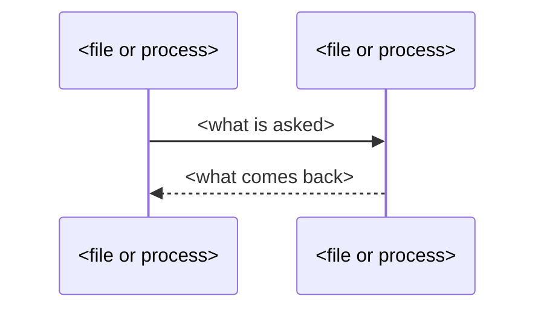
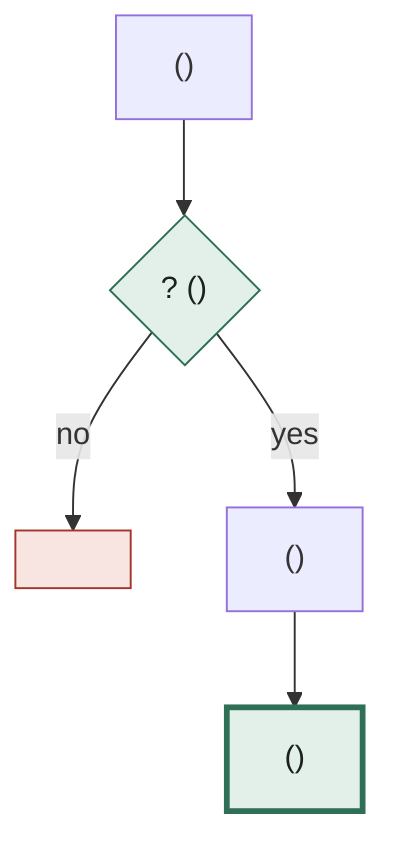

# Note templates

One template per note type. Text in `<angle brackets>` is replaced. Everything else is written as shown, so the check script can read it.

## Names and folders

| Note type | Folder | Name |
| --- | --- | --- |
| Start Here | target folder | `<Project> - Start Here` |
| Map | target folder | `<Project> - Map` |
| Glossary | target folder | `<Project> - Glossary` |
| End-to-End Flow | target folder | `<Project> flow - <what the flow does>` |
| File | `Files/` | `<Project> file - <file name>`. When another file of the same project has that file name, or the name is a generic one (`index`, `main`, `utils`, `common`, `__init__`), put the parent folder in front with ` - ` in place of `/`: `<Project> file - setup - common.js` |
| Mechanism | `Mechanisms/` | `<Project> mechanism - <what it does>` |
| Concept | `Concepts/` | `Concept - <term>` |
| any | | In every note name, write `-` for each of `[ ] # ^ \|` (a file `pages/[id].tsx` gives `<Project> file - pages - -id-.tsx`) |
| Library | `Libraries/` | `Library - <name>` |

Concept and Library notes are shared by every project in the vault. Before writing one, look for an existing note of that name:

| What is there | Do |
| --- | --- |
| No note of that name | Write it |
| A note with `written_by: argus` in its properties | Add this project's example and "Used in" line to it |
| A note without `written_by: argus` (someone's own note) | Do not change it. Write your note as `Concept - <term> (argus)` or `Library - <name> (argus)`, link to that one from your notes, and name the person's note in its "Related" line |

## Properties

Every note starts with properties. The check reads `written_by`, `type`, `source`, `source_hash`, `commit`, `depth`, `masked_lines`, `retired_blocks` and, on Mechanism and Flow notes, `sources`.

```markdown
---
type: file
written_by: argus
project: <Project>
source: <path of the source file, relative to the source root, with />
source_hash: <sha256: and 64 hex digits, the first word printed by: python -B <this skill's folder>/scripts/changed_blocks.py --source <source root> --hash <source>>
commit: <output of: git log -1 --format=%h -- <source file>>
depth: <map or full>
retired_blocks: <ids of blocks removed in later runs, with commas; leave the line out when there are none>
status: current
written: <YYYY-MM-DD>
---
```

| Property | Rule |
| --- | --- |
| `source_hash` | The hash of the source file's bytes as they were on disk when the note was written or last updated. Take it after the last read of the file. The check marks the note STALE when the file's hash differs later, with or without git, committed or not |
| `retired_blocks` | The ids of blocks that were removed from this note, for example `retired_blocks: 7a, 12`. An id in this list is never given to a block again, because other notes may still cite it. The check fails when a block uses one. Keep the list through a whole rewrite |
| `commit` | Information for the reader, and the stale test of notes that have no `source_hash`. When `git status --porcelain -- <source file>` prints a line (the work tree is dirty: the file has changes that are not committed), write the commit followed by `+uncommitted`, for example `0348189+uncommitted`. Without git, leave the line out |

Other types use `type: start`, `map`, `glossary`, `flow`, `mechanism`, `concept` or `library`, with `written_by: argus`, `project` and `written`. `written_by: argus` is on every note the skill writes: it is how a later run knows which notes it may change. Only File notes have `source` and `depth`. Concept and Library notes are shared, so they have no `project`; Concept notes have `language` instead. Mechanism and Flow notes also have `sources` (the source files they describe, relative to the source root, separated by commas), `source_hash` (one source file: that file's own value, the same as in its File note; several: one hash for all of them, the first word of the last line of `changed_blocks.py --source <source root> --hash <file> <file> ...`) and, with git, `commit` (the output of `git rev-parse --short HEAD`, with `+uncommitted` when one of the files has changes that are not committed): the check marks the note STALE when one of those files changes later.

## File note

````markdown
---
<properties, type: file>
---
# <Project> file - <file name>

Source: `<source path>`, <the project's version from its manifest, when it has one>, <N> lines.
Back to [[<Project> - Start Here]]. <Links to the Mechanism notes this file takes part in.>

## Level 1: purpose

| Lens | Answer |
| --- | --- |
| In one sentence | <...> |
| What we gain | <...> |
| What we lose | <...> |
| What was not possible without it | <... or "Not recorded in the code, the design notes or the history."> |
| Issues today | <...> |
| What it makes possible | <who uses this file, from the graph; name the files> |
| Open source used | <[[Library - ...]] links, or "none"> |
| Risks | <...> |

## Level 2: blocks

| # | Lines | Purpose | Why this way | Concepts |
| --- | --- | --- | --- | --- |
| 1 | <a-b> | <short phrase> | <the reason for this choice> | [[Concept - ...]], [[Concept - ...]] |

## Code and explanation

### Block 1: <purpose> (lines <a-b>)

```<language>
<exactly the source lines a to b>
```

<depth map: one to three sentences on what the block does and why, with [[Concept - ...]] links.>

<depth full: the line table, in place of the sentences.>

| Line | Code | What happens | Real value |
| --- | --- | --- | --- |
| <n> | `<the line as written, or its start followed by …>` | <plain words, with [[Concept - ...]] links> | <a value and where it comes from; "none"; or "not run"> |
| <n-m> | `<the start of one of those lines, followed by …>` | <one row for a statement that spans lines> | <...> |

<optional, for a line too rich for one cell: a small table, one row per part of the line. Its rows must not start with a number.>

| Part of line <n> | Meaning |
| --- | --- |

### Block 2: <purpose> (line <a>)

<same shape. Write "(line a)" for a one-line block.>

## Trace: <what is followed>

<depth full only. Say how the values were obtained: which input, which settings, which runtime version.>

| Step | Line | Variable | Value |
| --- | --- | --- | --- |

## Check your understanding

<depth full only. Two or three rows. At least one "what happens when…" and one "what breaks if line n is removed".>

| Question | Answer |
| --- | --- |
````

Rules the check enforces on a File note:

| Rule | Detail |
| --- | --- |
| Block heading | `### Block <id>: <purpose> (lines a-b)` or `(line a)`. The id is a number, or a number and letters: sub-blocks (`3a`), and blocks added in a later run (`7a`, `45ia`; see "Later runs" in `SKILL.md`) |
| Code fence | The first fence after the heading holds exactly source lines a to b |
| Coverage | The block ranges together contain every non-blank line once |
| Line tables (`depth: full`) | Inside each block, the rows whose first cell is a line number or range cover every non-blank line of that block once. Each has four cells; "What happens" and "Real value" are not empty. The Code cell quotes the row's first non-blank line: whole, or its start followed by `…` |
| Sections (`depth: full`) | `## Trace` and `## Check your understanding` are present |
| Lens | All eight lens rows are present in Level 1, each with an answer |
| Concepts | Every row of the Level 2 table has at least one `[[link]]` in its last cell |
| Graph | Every function or class the graph places in the file is named in the note's own words, outside the copied code (a block purpose or a row) |
| Masked secrets | Every line with `[masked]` is listed in the property `masked_lines` (for example `masked_lines: 12-14, 20`). Around each mask the line equals the source; a line may be `[masked]` alone. What a mask hides appears nowhere else in the note. At most a quarter of the file's non-blank lines are masked (two always allowed) |
| Empty file | A source with no non-blank line: lens table, "The file is empty." under Level 2, no block |
| Ownership | Only notes with `written_by: argus` are read by the check |
| Other notes | Mechanism, Library and Start Here notes have their lens rows, each with an answer. A Mechanism or Flow note has a Mermaid diagram that is not empty. A Flow note has an "Every outcome" table with a row, and names only block ids that exist (see "End-to-End Flow note"). No note holds an Obsidian comment (`%%`) outside code. The check warns about `<word>` outside code, which Obsidian hides. Every note is linked from another note |
| Stale | A note with `source_hash` is STALE when the hash of its source (its `sources`) differs now. A note without it is judged by `commit` and git |
| Every block explained | Each block has its row in the Level 2 table, and at `depth: map` at least one sentence of explanation after its code |

## Concept note

````markdown
---
<properties, type: concept>
---
# Concept - <term>

| Lens | Answer |
| --- | --- |
| What it is | <the full, precise meaning in plain words; name the language if it is specific to one> |
| What we gain | <...> |
| What we lose | <... or "Nothing."> |
| Without it | <what a programmer would have to do instead> |
| Issues | <what commonly goes wrong with it> |
| Risks | <... or "None known."> |

## Parts

| Part | In our code | Meaning |
| --- | --- | --- |

## Smallest real example

`<source path>` line <n>:

```<language>
<one to six real lines: the fewest that show it>
```

<The real value it produces, when there is one.>

## Used in

<[[File note]] block numbers or lines, one entry per project.>

Related: <[[Concept - ...]] links, each with three or four words on how it relates.>
````

A sign such as `=`, `===`, `!` or `? :` does not get a note of its own. All signs of one language go in one note, `Concept - operators and symbols`: the properties, one table (sign, how to read it, where in our code, the result there), a four-row lens (gain, lose, issues, risks) and "Used in". No "Parts" and no "Smallest real example".

General computing words go in one note, `Concept - computing words`: the properties, one table (word, meaning in one or two sentences) and "Used in".

## Mechanism note

````markdown
---
<properties, type: mechanism>
---
# <Project> mechanism - <what it does>

Source: <the files and line ranges that take part; a file with a note as a [[link]], a file without one as plain text with "no note yet">.
Back to [[<Project> - Start Here]].

<One sentence: what the behaviour is.>

## Words

| Word | Meaning |
| --- | --- |

## Purpose

<the eight-row lens table>

## Sequence



## Steps

| Step | File, line | What happens | Real value |
| --- | --- | --- | --- |

<One step table per path: the normal path, then each failure path, with "When it fails" as the last column.>

## Check your understanding

| Question | Answer |
| --- | --- |
````

## Library note

```markdown
---
<properties, type: library>
---
# Library - <name>

| Lens | Answer |
| --- | --- |
| What it is | <...> |
| Open source | <Yes or No; licence; where the project lives> |
| Version we use | <from the project's dependency file, with the file named> |
| What we gain | <...> |
| What we lose | <...> |
| What was not possible without it | <...> |
| Issues today | <...> |
| What it makes possible | <...> |
| Risks | <...> |

## Parts used

| Part | What it is | Where |
| --- | --- | --- |
```

A system service that is not open source but that the code depends on (an operating system feature, a cloud service) also gets a Library note, with "Open source: No".

## End-to-End Flow note

````markdown
---
<properties, type: flow>
---
# <Project> flow - <what the flow does>

<One sentence: the real input (a command line, a call, a request), and every way it can end; name the good end.>

Code read: <branch, commit, "plus uncommitted changes" when so>. Blocks are in [[<File note>]]<, [[<File note>]]>. Back to [[<Project> - Start Here]].

Who decides is in the colour of each box: green = the code, by a fixed check; yellow = a model; purple = a person; red = the run stops; grey = the results are thrown away; thick green = the good end.



## Steps

| Step | File, block | What happens | Value passed on |
| --- | --- | --- | --- |
| 1 | [[<File note>]] block <id> | <...> | <real value> |
| 2 | blocks <id> and <id> | <...> | <real value> |

## Every outcome

| Outcome | Where it is decided | What the person sees |
| --- | --- | --- |
| <an end state, as the code names it> | block <id> | <the message, the exit code, what was or was not done> |

## What each part cannot do

| Part | Cannot |
| --- | --- |
| <a program, a model, a person or the code itself that takes part> | <what the code makes impossible for it, from the code> |
````

Rules for a Flow note:

| Rule | Detail |
| --- | --- |
| Read, never guessed | Follow the code from the entry to every place where an outcome, a status or an error is set. Do not infer a stage from a name. An end state the code can reach that is not in the diagram and in "Every outcome" makes the note wrong |
| Decisions | A check is a branch node (`{"...?"}`) with one arrow per answer. Each end is a node of its own |
| Block ids | A node names the blocks it rests on in round brackets at the end of its text: `(53a)`, `(53a, 53b)`, `(32 to 34, 39)`. The Steps table writes `block 53a` or `blocks 53c and 53d`. The check fails when a named id is no block of a File note the Flow note links to; of `32 to 34` it looks at both ends |
| Who decides | Every node has one of the six classes. Leave out a class no node uses; do not add others |
| Size | One flow, one diagram. Above about 40 nodes, cut the flow into two notes at a natural point |
| Check | The diagram is not empty; "Every outcome" has at least one row; the named block ids exist. A project with File notes and no Flow note gets a WARN |

## Start Here note

```markdown
---
<properties, type: start>
---
# <Project> - Start Here

## Status

- <date>: <what is explained, at which depth; how many of how many files>.
- Code read: <source root, branch, version, commit>.
- <Open questions and "not recorded" cells that wait for an answer.>

## How to read these notes

| Step | Read | Why |
| --- | --- | --- |
| <n> | [[<Project> flow - ...]] <one row for every Flow note> | <the input it follows, as a diagram: every end and who decides> |

## The graph

<One sentence: the page shows every function of the project and what calls what, made by graphify from the code alone.> Open it in a browser: `<full path of <Project> graph.html>`. <Not a [[link]]: it is no note.>

<When the guided walk is not in the project: "Guided walk: `<full path of the .tour file>`. In VS Code, run the command CodeTour: Open Tour File... and choose it.">

## <Project> in one table

<the eight-row lens table, with a third column "Source": where each answer comes from>

## Map of the source files

<a Bases view when the obsidian-bases skill is installed; otherwise this table, in leaf-first order. Every source file of the project gets a row; a file without a note has "no note yet" in the last two cells.>

| File | Lines | Purpose | Depth | Note |
| --- | --- | --- | --- | --- |
```

## Map note

````markdown
---
<properties, type: map>
---
# <Project> - Map

```mermaid
flowchart TD
    <one node per source file; an arrow from a file to each file it uses; from the graph>
```

| Group | Files | What the group does |
| --- | --- | --- |
````

Above about 30 files, draw one diagram of groups and one diagram per group.

## Glossary note

```markdown
---
<properties, type: glossary>
---
# <Project> - Glossary

## Programming concepts

Read in this order: the "What it is" of each one needs only the ones above it. (Their "Related" lines may point further down.)

| # | Concept | In one line |
| --- | --- | --- |

## Mechanisms

| Mechanism | In one line |
| --- | --- |

## Libraries and system services

| Name | Open source | In one line |
| --- | --- | --- |

## Files explained

| File | Lines | Depth | In one line |
| --- | --- | --- | --- |
```
