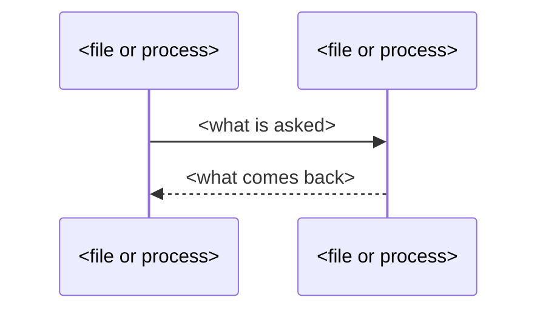

# Note templates

One template per note type. Text in `<angle brackets>` is replaced. Everything else is written as shown, so the check script can read it.

## Names and folders

| Note type | Folder | Name |
| --- | --- | --- |
| Start Here | target folder | `<Project> - Start Here` |
| Map | target folder | `<Project> - Map` |
| Glossary | target folder | `<Project> - Glossary` |
| End-to-End Flow | target folder | `<Project> flow - <what the flow does>` |
| File | `Files/` | `<Project> file - <file name>` (add the folder when two files share a name: `<Project> file - setup/common.js`, written with ` - ` in place of `/`) |
| Mechanism | `Mechanisms/` | `<Project> mechanism - <what it does>` |
| Concept | `Concepts/` | `Concept - <term>` |
| Library | `Libraries/` | `Library - <name>` |

Concept and Library notes are shared by every project in the vault. Before writing one, look for an existing note of that name and add this project's example and "Used in" line to it.

## Properties

Every note starts with properties. The check reads `type`, `source`, `commit` and `depth`.

```markdown
---
type: file
project: <Project>
source: <path of the source file, relative to the source root, with />
commit: <output of: git log -1 --format=%h -- <source file>>
depth: <map or full>
status: current
written: <YYYY-MM-DD>
---
```

Other types use `type: start`, `map`, `glossary`, `flow`, `mechanism`, `concept` or `library`, with `project` and `written`. Only File notes have `source`, `commit` and `depth`.

## File note

````markdown
---
<properties, type: file>
---
# <Project> file - <file name>

Source: `<source path>`, <version if the project has one>, <N> lines.
Back to [[<Project> - Start Here]]. <Links to the Mechanism notes this file takes part in.>

## Level 1: purpose

| Lens | Answer |
| --- | --- |
| In one sentence | <...> |
| What we gain | <...> |
| What we lose | <...> |
| What was not possible without it | <... or "Not recorded in the code, the design notes or the history."> |
| Issues today | <...> |
| What it makes possible | <who uses this file, from the graph; name the files> |
| Open source used | <[[Library - ...]] links, or "none"> |
| Risks | <...> |

## Level 2: blocks

| # | Lines | Purpose | Why this way | Concepts |
| --- | --- | --- | --- | --- |
| 1 | <a-b> | <short phrase> | <the reason for this choice> | [[Concept - ...]], [[Concept - ...]] |

## Code and explanation

### Block 1: <purpose> (lines <a-b>)

```<language>
<exactly the source lines a to b>
```

<depth map: one to three sentences on what the block does and why, with [[Concept - ...]] links.>

<depth full: the line table, in place of the sentences.>

| Line | Code | What happens | Real value |
| --- | --- | --- | --- |
| <n> | `<the line, or a short excerpt ending in …>` | <plain words, with [[Concept - ...]] links> | <a real value, "none", or "not run"> |
| <n-m> | `<excerpt>` | <one row for a statement that spans lines> | <...> |

### Block 2: <purpose> (line <a>)

<same shape. Write "(line a)" for a one-line block.>

## Trace: <what is followed>

<depth full only. Say how the values were obtained: which input, which settings, which runtime version.>

| Step | Line | Variable | Value |
| --- | --- | --- | --- |

## Check your understanding

<depth full only. Two or three rows. At least one "what happens when…" and one "what breaks if line n is removed".>

| Question | Answer |
| --- | --- |
````

Rules the check enforces on a File note:

| Rule | Detail |
| --- | --- |
| Block heading | `### Block <id>: <purpose> (lines a-b)` or `(line a)`. The id is a number, or a number and a letter for sub-blocks |
| Code fence | The first fence after the heading holds exactly source lines a to b |
| Coverage | The block ranges together contain every non-blank line once |
| Line tables (`depth: full`) | Inside each block, the rows that start with a line number or range cover every non-blank line of that block once |
| Lens | All eight lens rows are present in Level 1 |
| Concepts | Every row of the Level 2 table has at least one `[[link]]` |
| Masked secrets | A code line that contains `[masked]` is not compared |

## Concept note

````markdown
---
<properties, type: concept>
---
# Concept - <term>

| Lens | Answer |
| --- | --- |
| What it is | <the full, precise meaning in plain words; name the language if it is specific to one> |
| What we gain | <...> |
| What we lose | <... or "Nothing."> |
| Without it | <what a programmer would have to do instead> |
| Issues | <what commonly goes wrong with it> |
| Risks | <... or "None known."> |

## Parts

| Part | In our code | Meaning |
| --- | --- | --- |

## Smallest real example

`<source path>` line <n>:

```<language>
<two to six real lines>
```

<The real value it produces, when there is one.>

## Used in

<[[File note]] block numbers or lines, one entry per project.>

Related: <[[Concept - ...]] links, each with three or four words on how it relates.>
````

A sign such as `=`, `===`, `!` or `? :` does not get a note of its own. All signs of one language go in one note, `Concept - operators and symbols`, as a table: sign, how to read it, where in our code, the result there.

## Mechanism note

````markdown
---
<properties, type: mechanism>
---
# <Project> mechanism - <what it does>

Source: <the files and line ranges that take part>.
Back to [[<Project> - Start Here]].

<One sentence: what the behaviour is.>

## Words

| Word | Meaning |
| --- | --- |

## Purpose

<the eight-row lens table>

## Sequence



## Steps

| Step | File, line | What happens | Real value |
| --- | --- | --- | --- |

<One step table per path: the normal path, then each failure path, with "When it fails" as the last column.>

## Check your understanding

| Question | Answer |
| --- | --- |
````

## Library note

```markdown
---
<properties, type: library>
---
# Library - <name>

| Lens | Answer |
| --- | --- |
| What it is | <...> |
| Open source | <Yes or No; licence; where the project lives> |
| Version we use | <from the project's dependency file, with the file named> |
| What we gain | <...> |
| What we lose | <...> |
| What was not possible without it | <...> |
| Issues today | <...> |
| What it makes possible | <...> |
| Risks | <...> |

## Parts used

| Part | What it is | Where |
| --- | --- | --- |
```

A system service that is not open source but that the code depends on (an operating system feature, a cloud service) also gets a Library note, with "Open source: No".

## End-to-End Flow note

````markdown
---
<properties, type: flow>
---
# <Project> flow - <what the flow does>

<One sentence: the real input, and the result it ends in.>

```mermaid
flowchart LR
    <one node per file or process the flow passes through>
```

## Steps

| Step | File, block | What happens | Value passed on |
| --- | --- | --- | --- |
| 1 | [[<File note>]] block <n> | <...> | <real value> |

## Every outcome

| Outcome | Where it is decided | What the person sees |
| --- | --- | --- |
````

## Start Here note

```markdown
---
<properties, type: start>
---
# <Project> - Start Here

## Status

- <date>: <what is explained, at which depth; how many of how many files>.
- Code read: <source root, branch, version, commit>.
- <Open questions and "not recorded" cells that wait for an answer.>

## How to read these notes

| Step | Read | Why |
| --- | --- | --- |

## <Project> in one table

<the eight-row lens table, with a third column "Source": where each answer comes from>

## Map of the source files

<a Bases view when the obsidian-bases skill is installed; otherwise this table, in leaf-first order>

| File | Lines | Purpose | Depth | Note |
| --- | --- | --- | --- | --- |
```

## Map note

````markdown
---
<properties, type: map>
---
# <Project> - Map

```mermaid
flowchart TD
    <one node per source file; an arrow from a file to each file it uses; from the graph>
```

| Group | Files | What the group does |
| --- | --- | --- |
````

Above about 30 files, draw one diagram of groups and one diagram per group.

## Glossary note

```markdown
---
<properties, type: glossary>
---
# <Project> - Glossary

## Programming concepts

Read in this order: each one uses only the ones above it.

| # | Concept | In one line |
| --- | --- | --- |

## Mechanisms

| Mechanism | In one line |
| --- | --- |

## Libraries and system services

| Name | Open source | In one line |
| --- | --- | --- |

## Files explained

| File | Lines | Depth | In one line |
| --- | --- | --- | --- |
```
